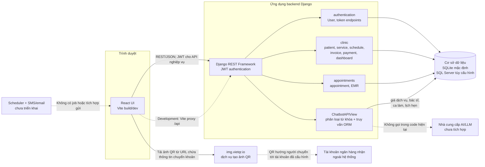
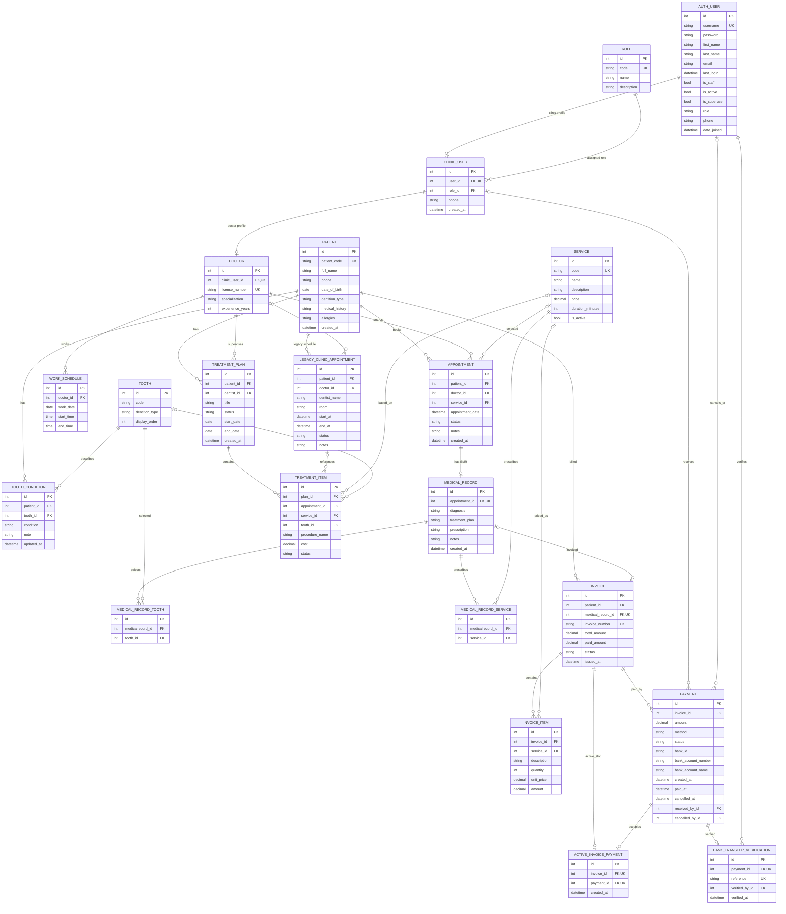
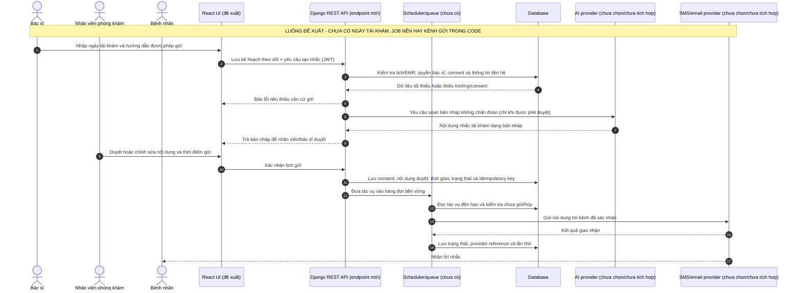

# Tài liệu kiến trúc và thiết kế hệ thống

## 1. Mục đích và phạm vi

Tài liệu này đối chiếu kiến trúc và mô hình dữ liệu với source Django/React hiện tại. Sơ đồ sequence AI ở mục 4 là **thiết kế đề xuất, chưa được triển khai**; chúng không mô tả hành vi production.

Sơ đồ ERD tập trung vào các model nghiệp vụ do Django quản lý. Các bảng nền tảng Django như `django_migrations`, `django_content_type`, `auth_group`, quyền, session và bảng quản trị không được vẽ đầy đủ. Các trường `id` tự tăng được lược khỏi sơ đồ để dễ đọc; các cột quan hệ và trường nghiệp vụ được ghi trực tiếp.

## 2. Kiến trúc hiện trạng



### Thành phần đang chạy

| Thành phần | Trách nhiệm hiện tại | Căn cứ trong source |
|---|---|---|
| React/Vite | Đăng nhập, màn hình theo vai trò, tiếp nhận, lịch, EMR, Billing, chatbot và dashboard. Trong development, Vite proxy `/api` tới Django. | `frontend/src/main.jsx`, `frontend/vite.config.js` |
| Django REST Framework | REST API; JWT cho API nghiệp vụ; role/permission được kiểm tra ở các view. | `backend/dms/settings.py`, `backend/dms/urls.py`, `backend/clinic/urls.py`, `backend/appointments/urls.py` |
| `authentication` | User tùy biến kế thừa Django `AbstractUser`; cấp và refresh JWT. | `backend/authentication/models.py`, `backend/authentication/urls.py` |
| `clinic` | Người dùng phòng khám, bác sĩ, bệnh nhân, răng, dịch vụ, ca làm, lập hóa đơn, thanh toán và analytics. | `backend/clinic/models.py`, `backend/clinic/views.py`, `backend/clinic/dashboard.py` |
| `appointments` | Lịch hẹn đang được dùng trong API và hồ sơ khám EMR. | `backend/appointments/models.py`, `backend/appointments/views.py` |
| Chatbot | Phân loại quy tắc giá/lịch, đọc dữ liệu từ ORM; không dùng LLM, không đọc hồ sơ bệnh án để trả lời. | `backend/appointments/chatbot.py` |
| Database | SQLite mặc định; có thể chọn SQL Server qua biến môi trường `DMS_DB_ENGINE=mssql`. | `backend/dms/settings.py` |
| Tạo ảnh VietQR | Frontend tải ảnh từ `img.vietqr.io` với mã ngân hàng, số tài khoản, tên chủ tài khoản, số tiền và nội dung chuyển khoản trong URL. Không xác minh giao dịch. | `backend/clinic/views.py`, `frontend/src/main.jsx` |

### Ranh giới hiện trạng và phần chưa có

- Không có dịch vụ AI/LLM bên ngoài trong đường chạy chatbot.
- Chưa có API hay tác vụ nền tóm tắt EMR bằng AI.
- Chưa có trường ngày tái khám, hàng đợi nhắc hẹn hoặc tích hợp gửi SMS/email trong model/API hiện tại.
- Luồng QR chỉ tạo QR và ghi nhận trạng thái chờ; đối soát hiện là thao tác nhân viên, không phải webhook ngân hàng.
- VietQR là dịch vụ ngoài dùng để dựng ảnh QR, không phải ngân hàng, cổng nhận tiền hay nguồn xác minh giao dịch.
- `backend/docker-compose.yml` hiện khai báo PostgreSQL và biến môi trường `DB_*`, trong khi `settings.py` chỉ cấu hình SQLite hoặc SQL Server qua `DMS_DB_*`; không nên xem compose đó là cấu hình triển khai đang hoạt động nếu chưa đồng bộ.
- Cấu hình hiện tại có `DEBUG=True`, khóa bí mật mặc định và `ALLOWED_HOSTS=['*']`; cần hardening cấu hình môi trường trước khi triển khai production.
- `backend/schema.sql` là schema SQLite nền cũ gồm 13 bảng clinic ban đầu, không bao gồm đầy đủ các model/migration hiện tại; dùng migration Django làm nguồn chuẩn cho database mới/cập nhật.

## 3. ERD theo model hiện tại

Sơ đồ dưới đây phản ánh model Django sau các migration hiện có. Có hai model mang tên lịch hẹn:

1. `appointments.Appointment` là model được router `/api/v1/appointments/` và chatbot sử dụng.
2. `clinic.Appointment` là model cũ vẫn còn trong app/schema; không nhầm nó với model lịch hẹn hiện dùng trong API.

`TreatmentPlan`/`TreatmentItem` cũng là các model clinic còn trong schema; không phải các bảng thay thế cho luồng EMR hiện dùng trong `appointments.MedicalRecord`.



### Quy tắc quan hệ đáng lưu ý

- `appointments.MedicalRecord.appointment` là one-to-one; một lịch có tối đa một EMR.
- `Invoice.medical_record` là one-to-one nullable; một EMR có tối đa một hóa đơn.
- Dịch vụ và răng được chọn trong EMR là quan hệ many-to-many, lưu qua bảng trung gian Django.
- `Payment` lưu lịch sử giao dịch; `ActiveInvoicePayment` là slot one-to-one bảo vệ việc chỉ có một giao dịch đang hiệu lực cho một hóa đơn. Slot được giải phóng khi QR pending bị hủy.
- `BankTransferVerification` là thông tin kiểm toán cho đối soát thủ công, một-một với Payment đã được xác minh; mã tham chiếu là duy nhất.
- Quan hệ/cột `SET_NULL`, nullable và các giá trị trạng thái phải được đọc cùng `backend/clinic/models.py` và `backend/appointments/models.py`; ERD tập trung thể hiện FK và cardinality, không mã hóa mọi `on_delete`.

## 4. Sequence cho hai luồng AI — đề xuất, chưa triển khai

Các luồng sau không có endpoint/model/provider tương ứng trong code hiện tại. Chúng là thiết kế tham khảo để nhóm thảo luận, không phải cam kết về nhà cung cấp, chi phí hoặc ngày triển khai. Nếu dùng mô hình bên ngoài, phải được phê duyệt trước khi gửi dữ liệu sức khỏe ra khỏi hệ thống.

### 4.1 Tóm tắt hồ sơ bệnh án bằng AI

```mermaid
sequenceDiagram
    autonumber
    actor Dentist as Bác sĩ
    participant UI as React UI (đề xuất)
    participant API as Django REST API (endpoint mới)
    participant DB as Database
    participant Guard as Kiểm tra quyền + giảm thiểu dữ liệu
    participant AI as AI provider (chưa chọn/chưa tích hợp)

    Note over Dentist,AI: LUỒNG ĐỀ XUẤT - CHƯA CÓ TRONG HỆ THỐNG HIỆN TẠI
    Dentist->>UI: Chọn EMR và yêu cầu tạo bản nháp tóm tắt
    UI->>API: POST yêu cầu với appointment/medical-record ID (JWT)
    API->>Guard: Xác thực JWT, role bác sĩ và quyền trên lịch được giao
    Guard-->>API: Cho phép hoặc từ chối
    API->>DB: Đọc EMR, lần khám và dữ liệu lâm sàng được phép
    DB-->>API: Chẩn đoán, kế hoạch, đơn thuốc, ghi chú, răng/dịch vụ
    API->>Guard: Loại bỏ định danh không cần thiết; áp dụng giới hạn nội dung
    Guard->>AI: Gửi dữ liệu tối thiểu theo chính sách đã được duyệt
    AI-->>Guard: Trả về bản nháp tóm tắt có cấu trúc
    Guard->>Guard: Kiểm tra schema, độ dài và nội dung không hợp lệ
    Guard-->>API: Bản nháp hoặc lỗi rõ ràng
    API-->>UI: Trả bản nháp, không tự lưu như chẩn đoán
    UI-->>Dentist: Hiển thị để bác sĩ rà soát/chỉnh sửa
    Dentist->>UI: Duyệt/chỉnh sửa hoặc loại bỏ
    UI->>API: Lưu theo hành động rõ ràng của bác sĩ
    API->>DB: Ghi vào trường lưu trữ có provenance/AI audit (cần thiết kế thêm)
    DB-->>API: Xác nhận lưu
    API-->>UI: Kết quả
```

**Cần thiết kế trước khi triển khai:** quyền truy cập hồ sơ, cơ sở pháp lý/đồng thuận, nhà cung cấp và chính sách lưu dữ liệu, trường lưu bản tóm tắt, phiên bản model/prompt, audit, xử lý lỗi và quy tắc bác sĩ chịu trách nhiệm duyệt. Không tự ghi đè `diagnosis`, `treatment_plan` hoặc `prescription`.

### 4.2 Sinh tin nhắn nhắc tái khám bằng AI



**Cần thiết kế trước khi triển khai:** trường ngày tái khám (hiện chưa có), consent/opt-out, số điện thoại/email đã xác minh, lịch gửi và múi giờ, mẫu nội dung được phép, review của nhân viên, nhà cung cấp, chính sách retry/idempotency, audit và xử lý yêu cầu hủy. Nội dung nhắc không được tiết lộ chẩn đoán nhạy cảm trên màn hình khóa/thông báo.

## 5. Kiểm tra nhất quán và giới hạn tài liệu

- Component diagram đã đối chiếu `INSTALLED_APPS`, URL routing, frontend Vite proxy, database settings, chatbot và VietQR URL builder.
- ERD được đối chiếu trực tiếp với các model Django và migration; phân biệt đúng hai model Appointment khác app.
- Hai sequence dùng participant tương lai có nhãn rõ ràng và chỉ ra thành phần/model/API còn thiếu; không trình bày AI summary hoặc reminder như chức năng hiện có.
- Tài liệu không thay thế migration/schema thực tế. Khi model thay đổi, cập nhật ERD cùng thay đổi model/migration và kiểm tra route/permission tương ứng.
- Chưa có quy ước tài liệu được nhóm xác nhận; cấu trúc hiện dùng Markdown + Mermaid để version-control, review bằng diff và render trên GitHub.

## 6. Nguồn đối chiếu trong repository

- `backend/dms/settings.py`, `backend/dms/urls.py`
- `backend/authentication/models.py`, `backend/authentication/urls.py`
- `backend/clinic/models.py`, `backend/clinic/urls.py`, `backend/clinic/views.py`, `backend/clinic/dashboard.py`
- `backend/appointments/models.py`, `backend/appointments/urls.py`, `backend/appointments/views.py`, `backend/appointments/chatbot.py`
- `frontend/src/main.jsx`, `frontend/vite.config.js`
