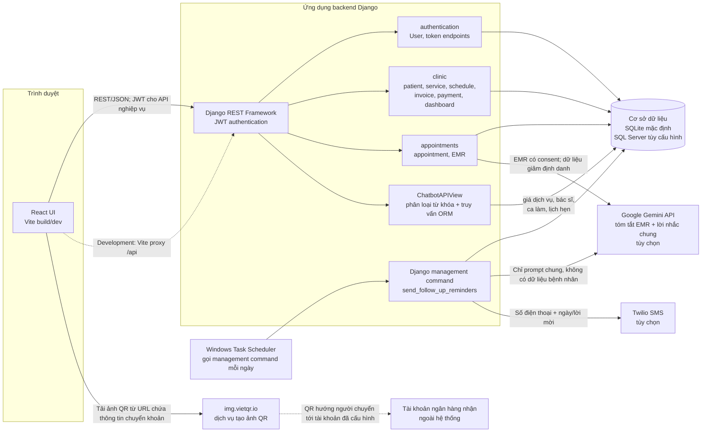
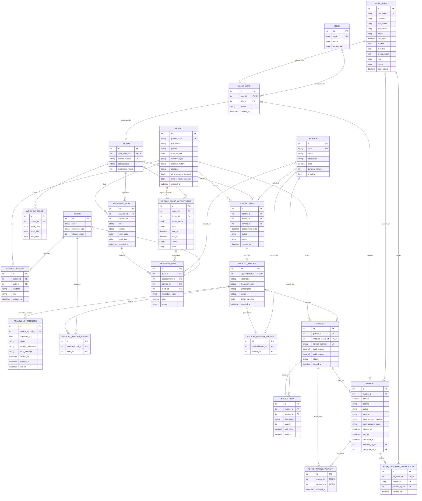

# Tài liệu kiến trúc và thiết kế hệ thống

## 1. Mục đích và phạm vi

Tài liệu này đối chiếu kiến trúc và mô hình dữ liệu với source Django/React hiện tại. Hai luồng Gemini (tóm tắt EMR và soạn lời nhắc chung) đã có trong source nhưng là tích hợp tùy chọn; cần consent, khóa nhà cung cấp và cấu hình lịch SMS trước khi hoạt động.

Sơ đồ ERD tập trung vào các model nghiệp vụ do Django quản lý. Các bảng nền tảng Django như `django_migrations`, `django_content_type`, `auth_group`, quyền, session và bảng quản trị không được vẽ đầy đủ. Các trường `id` tự tăng được lược khỏi sơ đồ để dễ đọc; các cột quan hệ và trường nghiệp vụ được ghi trực tiếp.

## 2. Kiến trúc hiện trạng



### Thành phần đang chạy

| Thành phần | Trách nhiệm hiện tại | Căn cứ trong source |
|---|---|---|
| React/Vite | Đăng nhập, màn hình theo vai trò, tiếp nhận, lịch, EMR, Billing, chatbot và dashboard. Trong development, Vite proxy `/api` tới Django. | `frontend/src/main.jsx`, `frontend/vite.config.js` |
| Django REST Framework | REST API; JWT cho API nghiệp vụ; role/permission được kiểm tra ở các view. | `backend/dms/settings.py`, `backend/dms/urls.py`, `backend/clinic/urls.py`, `backend/appointments/urls.py` |
| `authentication` | User tùy biến kế thừa Django `AbstractUser`; cấp và refresh JWT. | `backend/authentication/models.py`, `backend/authentication/urls.py` |
| `clinic` | Người dùng phòng khám, bác sĩ, bệnh nhân, răng, dịch vụ, ca làm, lập hóa đơn, thanh toán và analytics. | `backend/clinic/models.py`, `backend/clinic/views.py`, `backend/clinic/dashboard.py` |
| `appointments` | Lịch hẹn đang được dùng trong API và hồ sơ khám EMR. | `backend/appointments/models.py`, `backend/appointments/views.py` |
| Chatbot | Phân loại quy tắc giá/lịch, đọc dữ liệu từ ORM; không dùng LLM, không đọc hồ sơ bệnh án để trả lời. | `backend/appointments/chatbot.py` |
| Tóm tắt EMR | Endpoint bác sĩ/Admin có phân quyền và giới hạn tần suất; chỉ chạy khi bệnh nhân có consent và Gemini được cấu hình. Trả bản nháp, không ghi đè hồ sơ. | `backend/appointments/views.py`, `backend/appointments/ai_services.py` |
| Preview lời nhắc | Admin/Lễ tân có thể tạo preview cho bệnh nhân có SMS consent và ngày tái khám; chỉ gửi prompt chung cho Gemini, không gọi Twilio hoặc lưu/gửi tin nhắn. | `backend/clinic/views.py`, `frontend/src/main.jsx` |
| Nhắc tái khám | Management command đọc ngày tái khám và consent, tạo nội dung chung bằng Gemini rồi gửi qua Twilio; lịch chạy OS được cấu hình riêng. Preview trên UI độc lập, không phải nội dung được lưu/duyệt cho lần gửi sau. | `backend/appointments/management/commands/send_follow_up_reminders.py`, `backend/appointments/sms_services.py` |
| Database | SQLite mặc định; có thể chọn SQL Server qua biến môi trường `DMS_DB_ENGINE=mssql`. | `backend/dms/settings.py` |
| Tạo ảnh VietQR | Frontend tải ảnh từ `img.vietqr.io` với mã ngân hàng, số tài khoản, tên chủ tài khoản, số tiền và nội dung chuyển khoản trong URL. Không xác minh giao dịch. | `backend/clinic/views.py`, `frontend/src/main.jsx` |

### Ranh giới hiện trạng và điều kiện kích hoạt

- Không có dịch vụ AI/LLM bên ngoài trong đường chạy chatbot.
- Tóm tắt EMR gọi Gemini qua `POST /api/v1/medical-records/{id}/ai-summary/`; chỉ đọc hồ sơ đã lưu, cần `ai_processing_consent`, giới hạn 10 yêu cầu/giờ và trả kết quả chưa được lưu.
- Lễ tân/Admin xem trước lời nhắc qua `POST /api/v1/patients/{id}/reminder-preview/`; cần `sms_reminder_consent` và EMR có ngày tái khám. Endpoint chỉ trả câu nhắc/ngày/provider và `sent=false`, không trả số điện thoại hoặc nội dung hồ sơ.
- Trước khi gửi trường lâm sàng, backend loại bỏ các định danh nhận diện trực tiếp được phát hiện (tên/mã/điện thoại của bệnh nhân, email, ngày phổ biến). Đây là lọc theo mẫu, không bảo đảm dữ liệu được ẩn danh hoàn toàn; cần consent và duyệt chính sách xử lý dữ liệu của nhà cung cấp.
- Ngày tái khám được lưu trong `appointments.MedicalRecord.follow_up_date`; `Patient.sms_reminder_consent` và số điện thoại là điều kiện gửi. `FollowUpReminder` lưu trạng thái/mã Twilio và có unique key theo hồ sơ + ngày.
- Lệnh `python manage.py send_follow_up_reminders` cần được Windows Task Scheduler hoặc scheduler ngoài gọi hằng ngày; repository không tự đăng ký tác vụ hệ điều hành và tích hợp không hoạt động nếu thiếu biến môi trường Gemini/Twilio.
- Nội dung gửi SMS là lời mời chung có ngày tái khám, không gửi bệnh án tới Gemini. Lỗi gửi xác định được đánh dấu `FAILED`; kết quả Twilio không xác định thành `UNKNOWN` và không tự gửi lại.
- Luồng QR chỉ tạo QR và ghi nhận trạng thái chờ; đối soát hiện là thao tác nhân viên, không phải webhook ngân hàng.
- VietQR là dịch vụ ngoài dùng để dựng ảnh QR, không phải ngân hàng, cổng nhận tiền hay nguồn xác minh giao dịch.
- `backend/docker-compose.yml` hiện khai báo PostgreSQL và biến môi trường `DB_*`, trong khi `settings.py` chỉ cấu hình SQLite hoặc SQL Server qua `DMS_DB_*`; không nên xem compose đó là cấu hình triển khai đang hoạt động nếu chưa đồng bộ.
- `backend/schema.sql` là schema SQLite nền cũ gồm 13 bảng clinic ban đầu, không bao gồm đầy đủ các model/migration hiện tại; dùng migration Django làm nguồn chuẩn cho database mới/cập nhật.

## 3. ERD theo model hiện tại

Sơ đồ dưới đây phản ánh model Django sau các migration hiện có. Có hai model mang tên lịch hẹn:

1. `appointments.Appointment` là model được router `/api/v1/appointments/` và chatbot sử dụng.
2. `clinic.Appointment` là model cũ vẫn còn trong app/schema; không nhầm nó với model lịch hẹn hiện dùng trong API.

`TreatmentPlan`/`TreatmentItem` cũng là các model clinic còn trong schema; không phải các bảng thay thế cho luồng EMR hiện dùng trong `appointments.MedicalRecord`.



### Quy tắc quan hệ đáng lưu ý

- `appointments.MedicalRecord.appointment` là one-to-one; một lịch có tối đa một EMR.
- `Invoice.medical_record` là one-to-one nullable; một EMR có tối đa một hóa đơn.
- Dịch vụ và răng được chọn trong EMR là quan hệ many-to-many, lưu qua bảng trung gian Django.
- `Payment` lưu lịch sử giao dịch; `ActiveInvoicePayment` là slot one-to-one bảo vệ việc chỉ có một giao dịch đang hiệu lực cho một hóa đơn. Slot được giải phóng khi QR pending bị hủy.
- `BankTransferVerification` là thông tin kiểm toán cho đối soát thủ công, một-một với Payment đã được xác minh; mã tham chiếu là duy nhất.
- Quan hệ/cột `SET_NULL`, nullable và các giá trị trạng thái phải được đọc cùng `backend/clinic/models.py` và `backend/appointments/models.py`; ERD tập trung thể hiện FK và cardinality, không mã hóa mọi `on_delete`.

## 4. Sequence cho hai luồng AI tùy chọn

Các luồng dưới đây mô tả source hiện tại. Gemini và Twilio chỉ được gọi khi cấu hình credential; gửi SMS cần consent và một lịch chạy OS do đơn vị vận hành tự thiết lập. Không có API webhook ngân hàng hay chatbot LLM trong các luồng này.

### 4.1 Tóm tắt hồ sơ bệnh án bằng AI

```mermaid
sequenceDiagram
    autonumber
    actor Dentist as Bác sĩ
    participant UI as React UI
    participant API as Django REST API / MedicalRecordViewSet
    participant DB as Database
    participant AI as Google Gemini API

    Note over Dentist,AI: Tùy chọn; cần ai_processing_consent và DMS_GEMINI_API_KEY
    Dentist->>UI: Bấm tạo bản nháp trong EMR
    UI->>API: POST /api/v1/medical-records/{id}/ai-summary/ (JWT, body rỗng)
    API->>API: Xác thực vai trò Dentist/Admin
    API->>DB: Lấy EMR theo queryset giới hạn hồ sơ bác sĩ được giao
    DB-->>API: EMR và consent của bệnh nhân
    API->>API: Từ chối nếu chưa có ai_processing_consent
    API->>API: Lọc mẫu tên/mã/điện thoại, email và định dạng ngày
    API->>AI: Gửi chẩn đoán, kế hoạch, toa, ghi chú, dịch vụ/răng đã lọc
    AI-->>API: Văn bản tóm tắt
    API-->>UI: Trả summary và provider=Gemini; không lưu vào DB
    UI-->>Dentist: Hiển thị bản nháp để bác sĩ tham khảo
```

Endpoint chỉ nhận body rỗng, giới hạn 10 yêu cầu/giờ và không lưu summary. Thiếu cấu hình trả HTTP 503; lỗi gọi/đọc phản hồi Gemini trả HTTP 502. Việc lọc định danh là heuristic; không đảm bảo ẩn danh hoàn toàn. Summary có thể sai hoặc bỏ sót, không phải chẩn đoán/kết luận điều trị và cần bác sĩ đánh giá độc lập. Chỉ bật sau khi phòng khám phê duyệt consent và điều khoản xử lý dữ liệu sức khỏe của Gemini.

### 4.2 Sinh tin nhắn nhắc tái khám bằng AI

```mermaid
sequenceDiagram
    autonumber
    actor Patient as Bệnh nhân
    actor Dentist as Bác sĩ
    actor Staff as Lễ tân/Admin
    participant UI as React UI
    participant API as Django REST API / PatientViewSet
    participant DB as Database
    participant Scheduler as Windows Task Scheduler
    participant Command as Django management command
    participant AI as Google Gemini API
    participant SMS as Twilio SMS

    Note over Dentist,SMS: Tùy chọn; cần sms_reminder_consent, DMS_GEMINI_* và DMS_TWILIO_*
    Dentist->>UI: Nhập ngày tái khám trong EMR
    UI->>DB: Lưu MedicalRecord.follow_up_date
    Note over Patient,DB: Nhân viên ghi sms_reminder_consent và số điện thoại ở hồ sơ bệnh nhân
    opt Lễ tân/Admin xem trước nội dung
        Staff->>UI: Chọn bệnh nhân đã consent, yêu cầu preview
        UI->>API: POST /api/v1/patients/{id}/reminder-preview/
        API->>DB: Kiểm tra consent và lấy ngày tái khám
        DB-->>API: Chỉ ngày tái khám; không lấy EMR lâm sàng để prompt
        API->>AI: Xin câu mời chung, không có patient ID/phone/EMR
        AI-->>API: Lời mời chung
        API-->>UI: Trả ngày + preview; sent=false
        UI-->>Staff: Hiển thị preview; không gửi Twilio
    end
    Scheduler->>Command: Chạy send_follow_up_reminders hằng ngày
    Command->>DB: Tìm follow_up_date đến hạn/quá hạn, có consent
    DB-->>Command: Các EMR và số điện thoại đủ điều kiện
    Command->>DB: Tạo/claim FollowUpReminder duy nhất theo EMR + ngày
    Command->>AI: Xin một câu mời chung; không gửi dữ liệu bệnh nhân
    AI-->>Command: Câu SMS ngắn, không có thông tin lâm sàng
    loop Mỗi hồ sơ đủ điều kiện
        Command->>SMS: Gửi số điện thoại + ngày tái khám + lời mời chung
        SMS-->>Command: Provider reference hoặc lỗi/kết quả không rõ
        Command->>DB: Ghi SENT, FAILED hoặc UNKNOWN
        SMS-->>Patient: Nhận SMS (nếu Twilio chấp nhận)
    end
```

Command gửi lời mời chung có ngày tái khám, không đưa hồ sơ lâm sàng hay thông tin nhận diện vào prompt Gemini. `--dry-run` chỉ đếm hồ sơ đủ điều kiện, không gửi và không tạo delivery record. Delivery `FAILED` có thể được thử lại ở lần chạy sau; `UNKNOWN` không tự retry để tránh SMS trùng, cần đối chiếu trong Twilio. Trạng thái `SENDING` cũ hơn 30 phút được chuyển `UNKNOWN`. Command không tạo lịch hệ điều hành: cần tự cấu hình Task Scheduler, kiểm thử `--dry-run`, xác nhận tuyến gửi/chi phí SMS tại Twilio và chỉ sau đó mới chạy thật. Reminder preview trên giao diện là thao tác riêng: nó không gửi SMS, không lưu bản được duyệt và không bảo đảm nội dung giống tin nhắn Gemini tạo về sau trong command tự động.

## 5. Kiểm tra nhất quán và giới hạn tài liệu

- Component diagram đã đối chiếu `INSTALLED_APPS`, URL routing, frontend Vite proxy, database settings, chatbot và VietQR URL builder.
- ERD được đối chiếu trực tiếp với các model Django và migration; phân biệt đúng hai model Appointment khác app.
- Hai sequence được đối chiếu với endpoint, command, model và service thực tế; các tích hợp Gemini/Twilio được ghi rõ là tùy chọn, cần cấu hình và consent.
- Tài liệu không thay thế migration/schema thực tế. Khi model thay đổi, cập nhật ERD cùng thay đổi model/migration và kiểm tra route/permission tương ứng.
- Chưa có quy ước tài liệu được nhóm xác nhận; cấu trúc hiện dùng Markdown + Mermaid để version-control, review bằng diff và render trên GitHub.

## 6. Nguồn đối chiếu trong repository

- `backend/dms/settings.py`, `backend/dms/urls.py`
- `backend/authentication/models.py`, `backend/authentication/urls.py`
- `backend/clinic/models.py`, `backend/clinic/urls.py`, `backend/clinic/views.py`, `backend/clinic/dashboard.py`
- `backend/appointments/models.py`, `backend/appointments/urls.py`, `backend/appointments/views.py`, `backend/appointments/chatbot.py`, `backend/appointments/ai_services.py`, `backend/appointments/sms_services.py`, `backend/appointments/management/commands/send_follow_up_reminders.py`
- `frontend/src/main.jsx`, `frontend/vite.config.js`
