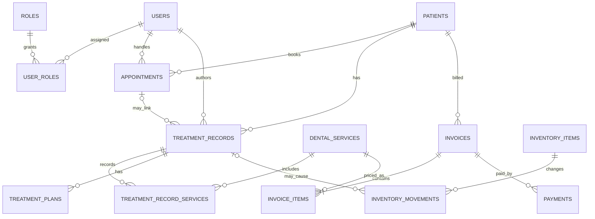

# Thiết kế CSDL hệ thống quản lý nha khoa

> Lược đồ dưới đây là đề xuất cho demo SQLite, không phải quy tắc nghiệp vụ đã được phòng khám duyệt. Các kiểu tiền tệ minh họa dùng số nguyên theo đơn vị nhỏ nhất (ví dụ đồng); xác nhận đơn vị và quy tắc làm tròn trước triển khai.

## 1. Entity và lý do tồn tại

`users`, `roles`, `user_roles` quản lý truy cập; `patients`, `appointments`, `treatment_records`, `treatment_plans` quản lý hành trình khám; `dental_services` và `treatment_record_services` quản lý danh mục/dịch vụ thực hiện; `invoices`, `invoice_items`, `payments` lưu nghĩa vụ và giao dịch; `inventory_items`, `inventory_movements` theo dõi vật tư và audit; `ai_requests`/`ai_report_requests` là tùy chọn để ghi nhận tác vụ AI đã được khử định danh. Không lưu API key trong CSDL.

## 2. Bảng thiết kế CSDL

| Bảng | Cột chính (kiểu SQLite) | Khóa/ràng buộc chính |
|---|---|---|
| `roles` | `id INTEGER`, `name TEXT` | PK `id`; `name` UNIQUE NOT NULL |
| `users` | `id INTEGER`, `username TEXT`, `password_hash TEXT`, `display_name TEXT`, `status TEXT` | PK; username UNIQUE; mật khẩu chỉ lưu hash; status có tập giá trị cần cấu hình |
| `user_roles` | `user_id INTEGER`, `role_id INTEGER` | PK ghép; FK đến users/roles; UNIQUE cặp |
| `patients` | `id INTEGER`, `patient_code TEXT`, `contact_data TEXT`, `created_at TEXT` | PK; mã duy nhất; dữ liệu định danh tách/giới hạn quyền, cấu trúc cụ thể cần quyết định |
| `appointments` | `id INTEGER`, `patient_id INTEGER`, `staff_user_id INTEGER`, `scheduled_at TEXT`, `service_id INTEGER NULL`, `status TEXT` | PK; FK; chỉ mục theo thời gian/trạng thái; chống trùng lịch phụ thuộc quy tắc và lịch làm việc |
| `treatment_records` | `id INTEGER`, `patient_id INTEGER`, `appointment_id INTEGER NULL`, `author_user_id INTEGER`, `occurred_at TEXT`, `clinical_notes TEXT` | PK; FK; quyền truy cập nghiêm ngặt |
| `dental_services` | `id INTEGER`, `service_code TEXT`, `name TEXT`, `description TEXT`, `price_minor INTEGER`, `status TEXT` | PK; mã UNIQUE; giá không âm; status active/inactive nếu được thống nhất |
| `treatment_record_services` | `treatment_record_id INTEGER`, `service_id INTEGER`, `quantity INTEGER`, `unit_price_minor INTEGER` | PK ghép hoặc id; FK; quantity > 0; giá không âm |
| `treatment_plans` | `id INTEGER`, `treatment_record_id INTEGER`, `author_user_id INTEGER`, `content TEXT`, `status TEXT`, `created_at TEXT` | PK/FK; status cần thống nhất; nội dung chỉ người có quyền |
| `invoices` | `id INTEGER`, `patient_id INTEGER`, `invoice_date TEXT`, `status TEXT`, `discount_amount INTEGER`, `total_amount INTEGER` | PK/FK; tiền không âm; trạng thái phụ thuộc quy trình |
| `invoice_items` | `id INTEGER`, `invoice_id INTEGER`, `dental_service_id INTEGER`, `quantity INTEGER`, `unit_price INTEGER` | PK/FK; quantity > 0, price không âm; lưu snapshot đơn giá nếu nghiệp vụ yêu cầu |
| `payments` | `id INTEGER`, `invoice_id INTEGER`, `amount INTEGER`, `method TEXT`, `status TEXT`, `transaction_ref TEXT NULL`, `created_at TEXT` | PK/FK; amount không âm; tránh lưu dữ liệu thẻ nhạy cảm; xử lý nhiều lần thanh toán cần xác nhận |
| `inventory_items` | `id INTEGER`, `item_code TEXT`, `name TEXT`, `unit TEXT`, `stock_quantity REAL`, `status TEXT` | PK; item_code UNIQUE; không âm nếu chính sách cấm tồn âm |
| `inventory_movements` | `id INTEGER`, `inventory_item_id INTEGER`, `quantity_delta REAL`, `reason TEXT`, `treatment_record_id INTEGER NULL`, `idempotency_key TEXT UNIQUE`, `created_at TEXT` | PK/FK; movement bất biến; quy tắc số lượng/loại giao dịch cần xác nhận |
| `ai_requests` (tùy chọn) | `id INTEGER`, `request_type TEXT`, `actor_user_id INTEGER NULL`, `source_ref TEXT NULL`, `status TEXT`, `created_at TEXT` | PK/FK; không lưu prompt chứa dữ liệu bệnh nhân thô nếu không cần |
| `ai_report_requests` (tùy chọn) | `id INTEGER`, `actor_user_id INTEGER`, `period_start TEXT`, `period_end TEXT`, `status TEXT`, `created_at TEXT` | PK/FK; chỉ lưu truy vấn/bối cảnh tổng hợp được phép |

`TEXT` JSON chỉ dùng khi cấu trúc trường đã được xác định; không nên gom dữ liệu nhạy cảm thành JSON tùy tiện nếu khó phân quyền/xóa/kiểm toán. SQLite không có kiểu DECIMAL thực chính xác như một số DB khác; dùng số nguyên đơn vị nhỏ nhất hoặc biểu diễn chính xác được thống nhất.

## 3. Quan hệ

- `roles` n-n `users` qua `user_roles`.
- `patients` 1-n `appointments`, `treatment_records`, `invoices`.
- `users` 1-n lịch hẹn được phụ trách và hồ sơ do người dùng tạo.
- `treatment_records` n-n `dental_services` qua `treatment_record_services`.
- `treatment_records` 1-n `treatment_plans` (nếu phiên bản hóa kế hoạch được yêu cầu).
- `invoices` 1-n `invoice_items`, `payments`; `dental_services` 1-n `invoice_items`.
- `inventory_items` 1-n `inventory_movements`; movement có thể tham chiếu hồ sơ điều trị.
- Tác vụ AI có thể tham chiếu ID nghiệp vụ tối thiểu nhưng không cần mang dữ liệu sức khỏe vào bảng nhật ký.

## 4. Chỉ mục gợi ý

- UNIQUE `users(username)`, `roles(name)`, `patients(patient_code)`, `dental_services(service_code)`, `inventory_items(item_code)`.
- `appointments(scheduled_at, status)`, `appointments(patient_id, scheduled_at)`.
- `treatment_records(patient_id, occurred_at)`.
- `invoices(invoice_date, status)`, `invoice_items(invoice_id)`, `payments(invoice_id, status)`.
- `inventory_movements(inventory_item_id, created_at)`.
- Bảo đảm mọi FK được bật (`PRAGMA foreign_keys = ON`) trong kết nối SQLite.

## 5. Mermaid ERD

## 6. Giả định và điểm cần xác minh

- Actor/ma trận quyền: tài liệu nền xác định Admin, Bác sĩ, Lễ tân; vai trò phụ tá/chủ phòng khám cần chốt.
- Lịch bác sĩ làm việc, tránh trùng lịch, tái khám và trạng thái lịch/hóa đơn chưa được mô tả đầy đủ.
- Chốt thời điểm ghi nhận tiêu hao vật tư, cho phép tồn âm, nhập/kiểm kê, sửa/hủy và hoàn vật tư.
- Chốt công thức doanh thu/giảm giá, thanh toán nhiều đợt, hoàn tiền và audit.
- Chốt retention, consent, quy trình khử định danh, nhà cung cấp AI và dữ liệu được phép gửi. Cần kiểm chứng yêu cầu pháp lý với bên phụ trách; không khẳng định chuẩn cụ thể ở đây.
- AI không đưa ra chẩn đoán/khuyến nghị điều trị; bác sĩ phải duyệt nội dung chuyên môn.
