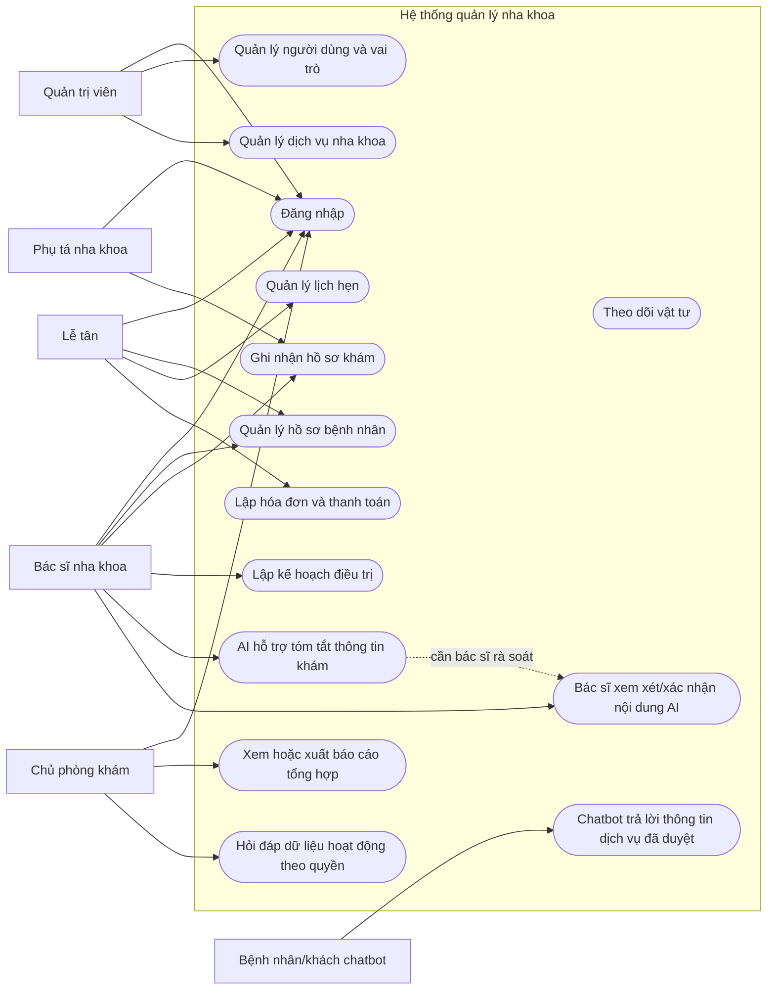
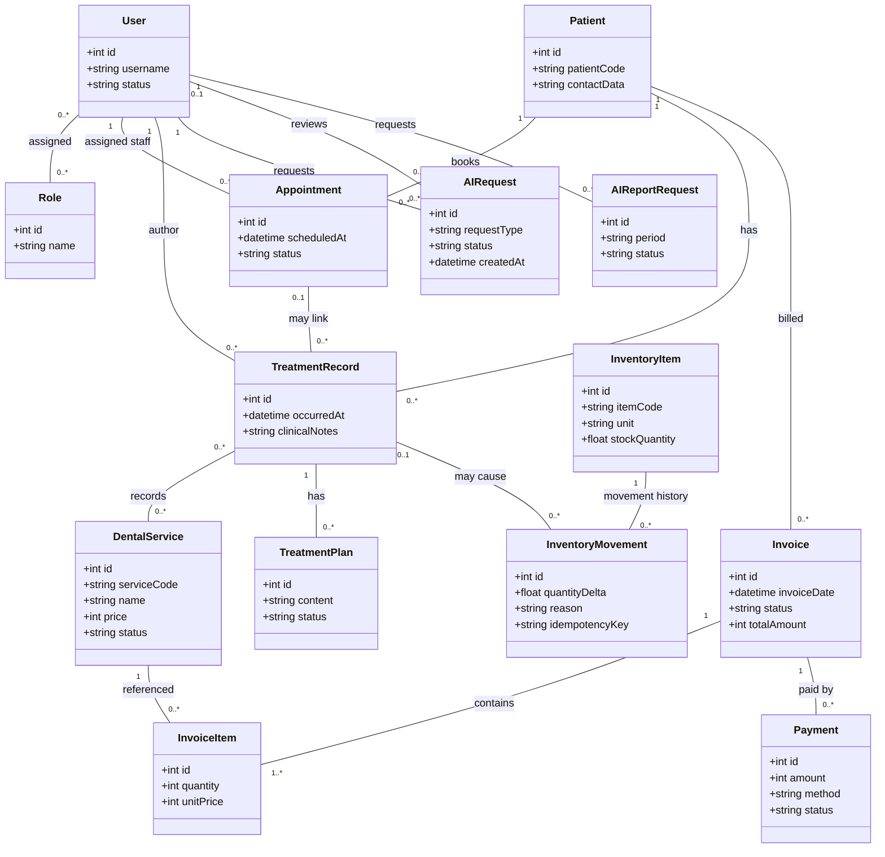

# UML hệ thống quản lý nha khoa tích hợp AI

## 1. Use Case Diagram (Mermaid)

## 2. Class Diagram (Mermaid)

## 3. Giải thích quan hệ và giả định

- Người dùng có thể có nhiều vai trò; hồ sơ bệnh nhân, lịch hẹn và ghi chú khám chỉ truy cập theo quyền. Sơ đồ không thể hiện chính sách chi tiết — cần ma trận authz.
- Lịch hẹn có thể liên kết hồ sơ khám; một hồ sơ có thể có nhiều dịch vụ/kế hoạch, tùy quy tắc lưu lịch sử.
- Hóa đơn chứa dòng dịch vụ và có thể có nhiều lần ghi nhận thanh toán; quy tắc thanh toán nhiều đợt, hủy/hoàn cần xác nhận.
- Biến động vật tư lưu lịch sử; cập nhật snapshot cùng movement phải transaction và idempotent. Việc hủy hóa đơn không tự động hoàn vật tư đã tiêu hao.
- `AIRequest` là tác vụ hỗ trợ; `reviewer` thể hiện việc con người rà soát, không tạo quyền để AI tự chẩn đoán hoặc tự cập nhật hồ sơ. `AIReportRequest` chỉ nên dùng dữ liệu tổng hợp theo quyền.
- Dùng giá nguyên đồng trong minh họa; kiểu số lượng vật tư, retention, actor khách hàng và các thuộc tính cần được xác nhận với thiết kế thật.
